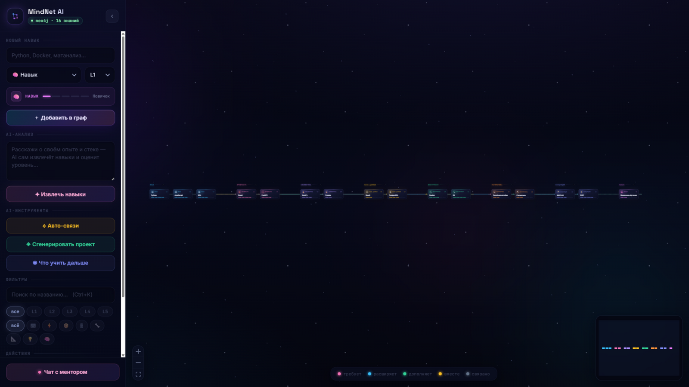
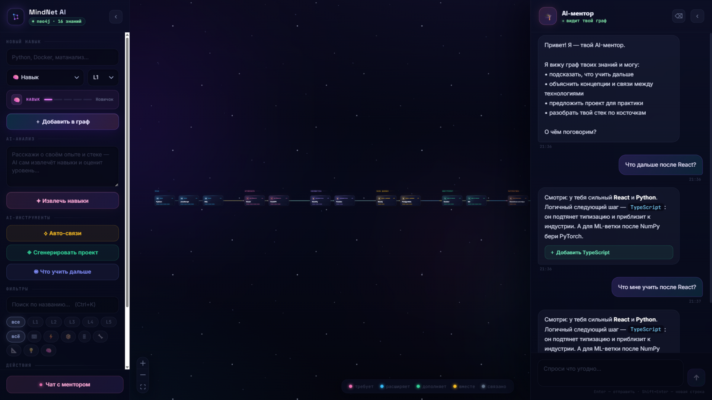

# 🧠 MindNet AI

**Внешний мозг для разработчика и студента** — интерактивная карта знаний с ИИ-аналитикой.

    



## 🎯 О проекте

MindNet AI — это не просто заметки. Это **граф знаний**, который визуализирует твои навыки, технологии и учебные предметы в виде интерактивной карты-созвездия: навыки группируются по категориям, связи подписаны и расцвечены, а фон — живая туманность со звёздами.



### 🔥 Ключевые возможности

- **Интерактивный граф** — узлы-созвездия по категориям, редактирование навыка кликом (название, тип, уровень, удаление)
- **ИИ-аналитик** — рекомендует, что изучать дальше
- **Генератор проектов** — предлагает пет-проекты на основе твоих навыков
- **Извлечение навыков из текста** — опиши свой опыт, AI сам разложит его на граф
- **Чат с ментором** — видит твой граф, история переживает перезапуск
- **Бэкап вселенной** — экспорт/импорт графа в JSON одним кликом
- **Живой интерфейс** — тёмная космическая тема, сплэш-экран, горячие клавиши (`Ctrl+K` — поиск, `Esc` — закрыть панели)

## 🏗 Архитектура

| Слой | Технологии | Где лежит |
|---|---|---|
| Бэкенд | Python 3.10+, FastAPI, Neo4j 5.x (driver), pydantic v2 | `backend/` |
| Фронтенд | React 18 + Vite 5, reactflow, axios | `frontend/` |
| Десктоп | Electron 28 + electron-builder, кастомная упаковка | `frontend/electron-app/` |
| ИИ | мультипровайдерный слой с фолбэком (Gemini → Qwen / OpenAI-совместимые API) | `backend/ai_service.py`, `backend/ai_layer.py` |

## 🚀 Быстрый старт

### Требования

- Python 3.10+
- Node.js 18+
- Neo4j 5.x (Neo4j Desktop или Docker)

### 1. Клонировать репозиторий

```bash
git clone https://github.com/fendercm/MindNet-AI.git
cd MindNet-AI
```

### 2. Настроить бэкенд

```bash
cd backend
python -m venv .venv
.venv\Scripts\activate            # Windows
pip install -r requirements.txt
copy .env.example .env            # затем вписать свои ключи в .env
```

### 3. Запустить Neo4j

По умолчанию бэкенд подключается к `bolt://127.0.0.1:7687`, пользователь `neo4j`, пароль `password` (переопределяется в `.env`: `NEO4J_URI`, `NEO4J_USER`, `NEO4J_PASSWORD`).

### 4. Запустить бэкенд

```bash
uvicorn main:app --reload         # http://localhost:8000, /health для проверки
```

### 5. Запустить фронтенд

```bash
cd frontend
npm install
npm run dev                       # дев-режим в браузере
npm run electron:dev              # дев-режим в Electron
```

## 🧪 Тесты и CI

```bash
cd frontend
npm test                          # vitest: парсер данных, раскладка, вьюпорт
npx eslint src                    # статический анализ
```

GitHub Actions (`.github/workflows/ci.yml`) прогоняет lint, тесты и сборку на каждый push.

## 📦 Сборка десктоп-приложения (Windows)

Одной командой из корня репозитория:

```bat
build.bat
```

Скрипт: проверяет `backend\.env` (при отсутствии создаёт из `.env.example` и открывает для заполнения), ставит зависимости фронтенда и Electron, собирает Vite-бандл и упаковывает всё в `frontend\electron-app\release\MindNet AI\MindNet AI.exe`.

> ⚠️ `build.bat` копирует `backend\.env` в релизную папку — не распространяйте собранный exe с боевыми ключами.

## ⚙️ Переменные окружения (`backend/.env`)

| Переменная | Назначение |
|---|---|
| `GEMINI_API_KEY` | ключ Google Gemini (основной провайдер) |
| `AI_PRIMARY` / `AI_FALLBACK` | порядок провайдеров, например `gemini,qwen3` |
| `AI_TIMEOUT` | таймаут запроса к ИИ |
| `OPENAI_API_KEY` / `OPENAI_MODEL` | OpenAI-совместимый endpoint |
| `USE_PROXY` / `PROXY_URL` | прокси для исходящих запросов |
| `NEO4J_URI` / `NEO4J_USER` / `NEO4J_PASSWORD` | подключение к БД |

## 🗂 Структура

```
backend/
├── main.py            # FastAPI: /nodes (CRUD), /edges, /graph, /health, /ai/*
├── crud.py            # операции над графом (включая update/delete узла)
├── database.py        # подключение к Neo4j
├── schemas.py         # pydantic-схемы
├── ai_service.py      # мультипровайдерный ИИ-слой с фолбэком
├── ai_layer.py        # декомпозиция текста в дерево навыков
└── requirements.txt
frontend/
├── src/
│   ├── components/    # GraphCanvas (канва), ChatPanel (ментор)
│   ├── lib/graph.js   # чистая логика: парсер, раскладка, вьюпорт (+ тесты)
│   ├── fonts/         # шрифты вшиты — приложение работает офлайн
│   └── api/client.js  # типизированный клиент API
└── electron-app/      # оболочка Electron + упаковка
docs/img/              # скриншоты
build.bat              # сборка десктоп-версии в один клик
```

## 📄 Лицензия

MIT — см. [LICENSE](LICENSE).
